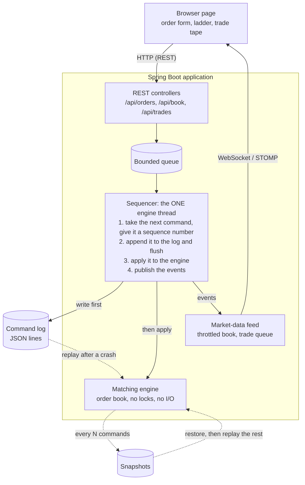

# Matching Engine

A single-symbol stock-exchange matching engine in Java 21: price-time priority, a write-ahead command log
with crash recovery, a REST and WebSocket API, and a live order-book page. Built as a learning project,
phase by phase, with tests and a seeded simulation checking every step.

**Live demo:** https://matching-engine-hwru.onrender.com
*(Free hosting, see [docs/DEPLOY.md](docs/DEPLOY.md): it sleeps when idle, so the first load after a quiet spell
is slow (Render's dashboard says requests can be delayed by "50 seconds or more"), and its data is erased on every
restart. Press **Simulate traffic** to fill the book.)*

## Architecture



The engine thread is the only thing that ever touches the order book, so the engine needs no locks. HTTP
threads only put commands on a bounded queue and wait for the answer. The browser never talks to the
engine: it sends REST requests and listens to a read-only feed.

Packages: `engine` (pure matching, no I/O, no Spring), `infra` (commands, log, snapshots, recovery, the
sequencer), `api` (Spring Boot REST, WebSocket feed, health check), `sim` (seeded simulation, crash demo).

## Features

- **Order types:** limit (GTC, IOC, FOK) and market (always IOC).
- **Order changes:** cancel, and modify (a size reduction keeps queue position; a price change or size increase loses it).
- **Matching:** best price first, then earliest arrival; trades happen at the **resting** order's price.
- **Event stream:** accepted, rejected, trade executed, cancelled, modified.
- **Durability:** every command is written to a JSON-lines log **before** it is applied.
- **Recovery:** rebuild the exact book from the log, or from the newest usable snapshot plus the commands after it.
- **REST API** to place, cancel and modify orders, read the book and recent trades, and run a traffic simulation.
- **Live page** (plain HTML/CSS/JS, no framework): order form, order-book ladder, trade tape, works on a phone.
- **Health check:** `GET /actuator/health` reports `UP`, or `DOWN` if the engine thread has stopped after a failure.
- **Docker image** (multi-stage, runs as a non-root user) and a step-by-step guide to deploy it on Render.

## Design decisions, and why

| Decision | Why |
|---|---|
| **Prices are `long` paise, never `double`** | Floating point cannot represent values like 0.10 exactly, and money must be exact. Rupee text (`"40.50"`) exists only at the HTTP edge. |
| **Price levels: sorted primitive arrays, with an `ArrayDeque` queue per level** | Best price first, then earliest arrival, needs the best price fast and a FIFO queue at each price. I first used a `TreeMap<Long, PriceLevel>`; profiling showed it was the largest CPU cost (about 27%) and `Long` boxing the largest allocation, so I replaced it (Phase 10). The trade-off: inserting a *new* price level costs O(P) instead of O(log P), fine for a few hundred levels, poor for millions. |
| **An id-to-order `HashMap` index** | Cancelling must find an order by id without scanning the book. |
| **A single writer thread (the LMAX idea)** | No lock contention around the engine, and one reproducible order of events. All the concurrency in the system is one queue. |
| **Log the command before applying it** | If the process dies, the log has every command that was applied. This is *command* logging: the log stores the inputs, not the events. |
| **Determinism: no clock, no randomness inside the engine** | The same commands in the same order always give the same trades and the same book, so replaying the log rebuilds the exact state. A test compares a SHA-256 fingerprint of the book. |
| **Invariants checked after every operation (in tests and the simulation)** | A corrupt book is found at the operation that broke it, not hours later from a strange trade. Checks include: no crossed book, no empty levels, orders in sequence order, index and book agree. |
| **Fail-stop** | If the log cannot be written, the engine stops and every waiting caller is released with an error. Nothing unlogged is ever applied. |
| **The engine thread never waits on a network client** | The book feed is a throttled "something changed" flag (at most one update per 100 ms), and trades go through a bounded queue to a separate thread. A slow browser cannot slow matching. |
| **FOK counts available quantity before trading** | A fill-or-kill that cannot fill changes nothing. |
| **The order book refuses to hold anything but a GTC limit order** | Market, IOC and FOK orders can never be left resting by mistake. |
| **Strict JSON in** | Unknown fields, `10.5` for a whole number, and a number where the price string belongs are refused, because guessing about money is a bug. |

## Benchmarks

Measured with JMH on one laptop (AMD Ryzen 5 5625U, Windows 11, Java 21, 1 GB heap), on a seeded synthetic
workload: 60% limit orders, 10% market, 20% cancels, 10% modifies, about 2,000 resting orders at the start.
Full method, caveats and raw results: [BENCHMARKS.md](BENCHMARKS.md).

| | Before (`TreeMap`) run 1 | Before, run 2 (control) | After (primitive arrays) |
|---|---|---|---|
| Throughput (ops/s) | 4,849,313 ± 117,794 | 4,782,590 ± 362,972 | **5,908,741 ± 298,680** |
| Mean latency per operation | 320.5 ns | 287.4 ns | **249.5 ns** |
| p50 / p99 latency | 200 / 900 ns | 200 / 900 ns | 200 / 800 ns |
| Allocation per operation | 480.3 bytes | not measured | **421.8 bytes** |

Throughput was **about 23% higher** after the change (+22.7% against the mean of the two "before" runs), and
the slowest "after" fork was faster than the fastest "before" fork. Read the limits before quoting any number:

- It measures the **engine only**. It excludes the queue, the JSON log and its `flush()` after every command,
  snapshots and the network. An end-to-end exchange would be much slower, because logging dominates. I have
  not measured it end to end.
- The workload is synthetic, one instrument, a narrow price band, and the same operations replay every batch.
- One busy laptop, not an isolated benchmark machine. The ratio is more portable than the absolute numbers.
- Tail latency (p99.9 and beyond) moved by up to 14% between two identical runs, so treat it as noise.

## Run it locally

### With Maven (Java 21 and Maven)

```bash
mvn test                  # all tests, plus a coverage report in target/site/jacoco/index.html
mvn spring-boot:run       # the server: open http://localhost:8080/
```

Press **Simulate traffic** on the page to fill the book, or place two crossing orders yourself.
Health check: <http://localhost:8080/actuator/health>.

Run the seeded simulation on its own (default seed 42, 100,000 operations):

```bash
mvn compile
java -cp target/classes com.sanjeev.sim.Simulation 42 100000
```

### With Docker

```bash
docker build -t matching-engine:local .
docker run --rm -p 8080:8080 --name matching-engine matching-engine:local
```

Then open <http://localhost:8080/>. Hosting platforms set the `PORT` variable and the server follows it.
The image is built in two stages (Maven builds the jar; only a small Java runtime image ships) and runs as
a non-root user.

### REST API

| Call | What it does |
|---|---|
| `POST /api/orders` | Place an order: `{"trader":"Anu","side":"BUY","type":"LIMIT","price":"40.50","quantity":10}` (the price is a **string**, `timeInForce` optional). |
| `DELETE /api/orders/{id}` | Cancel a resting order. |
| `PATCH /api/orders/{id}` | Change a resting order: `{"price":"40.60","quantity":8}`. |
| `GET /api/book?depth=10` | The top levels of each side. |
| `GET /api/trades?limit=50` | The most recent trades, newest first. |
| `POST /api/simulate?count=1000` | Run seeded random traffic through the real exchange (1 to 10,000 operations). |

Live feed: STOMP over WebSocket at `/ws`, topics `/topic/book` (top 10 levels, at most every 100 ms) and
`/topic/trades` (every trade, in order). The feed is read-only.

## Testing approach

- **Unit tests** for every behaviour, with names that read as sentences. 670 tests in total.
- **Invariants:** a book checker (`BookInvariants`) runs after every operation in the engine tests and in the simulation.
- **Seeded simulation:** 100,000 random operations (the same seed always gives the same run), checking the book after each one, that quantity is conserved, and that every trade follows price-time priority and happens at the resting price. It found a real sequence-number bug on its first run. I also **mutation-checked** it: six deliberate engine bugs were each caught by the simulation alone.
- **Replay and recovery:** tests crash the sequencer, then rebuild the engine from the log (and from snapshots) and compare the exact book fingerprint. Damaged or half-written log lines are handled (a torn last line is skipped; corruption anywhere else is refused).
- **Concurrency:** many producer threads against the single engine thread; the full queue, a failing disk and an interrupted engine thread all have tests.
- **Integration:** a real server, a real WebSocket and a real STOMP client; including a check that another website's origin is refused.
- **Coverage:** measured by JaCoCo on every `mvn test`: 95.7% of lines and 94.0% of branches overall (engine 99.6%, infra 99.3%, api 98.9%). The `sim` package is lower (82%) because it includes the demo programs and command-line printing.

## Known limitations

- Single symbol, single process.
- **No authentication and no rate limit:** anyone who can reach the server can trade and run simulations.
- **The server does not resume an old log on start:** every start opens a fresh run folder. Recovery is built and tested, but not yet wired into start-up.
- **Self-trades are allowed** (a trader can trade with themself). Real exchanges prevent this.
- Duplicate order ids are only rejected while the original order is resting.
- The log is flushed to the operating system, not fsynced: a power cut could lose the last few lines (a process crash loses nothing).
- It is deployed on Render's free plan (512 MB, 0.1 CPU): the first deploy took 2 min 38 s and the app logged "Started in 59 seconds". The free plan has no persistent disk, so the exchange **starts empty after every restart or sleep**; see [docs/DEPLOY.md](docs/DEPLOY.md).

## What I would do next

- **Multiple symbols:** one engine, log and sequencer per symbol, which is how this design scales out.
- **A binary protocol** (for example a fixed-layout binary format) instead of JSON, to cut parsing and allocation.
- **A Disruptor-style ring buffer** in place of the `ArrayBlockingQueue`, to cut hand-off latency between producers and the engine thread. I would measure it before claiming any gain.
- Resume from the log and snapshots on start-up, fsync the log, rate limiting and authentication, and self-trade prevention.

## Documentation

- [docs/DEPLOY.md](docs/DEPLOY.md): deploy to Render, step by step.
- [BENCHMARKS.md](BENCHMARKS.md): the benchmark method, results and limits in full.
