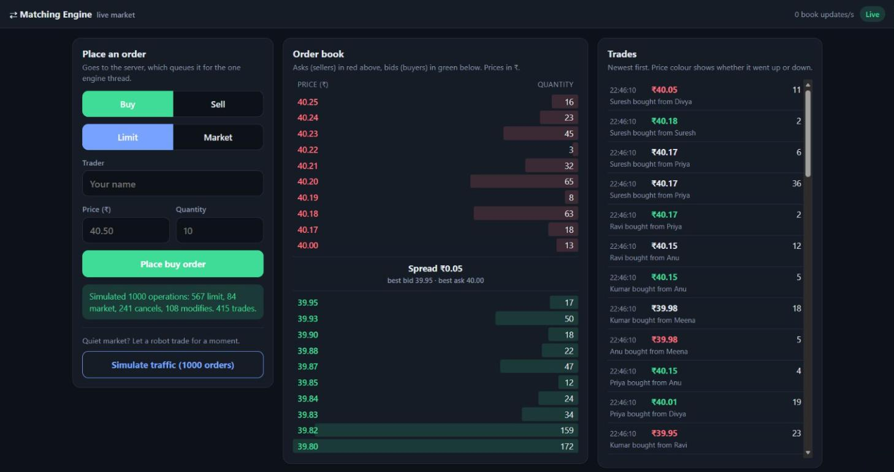
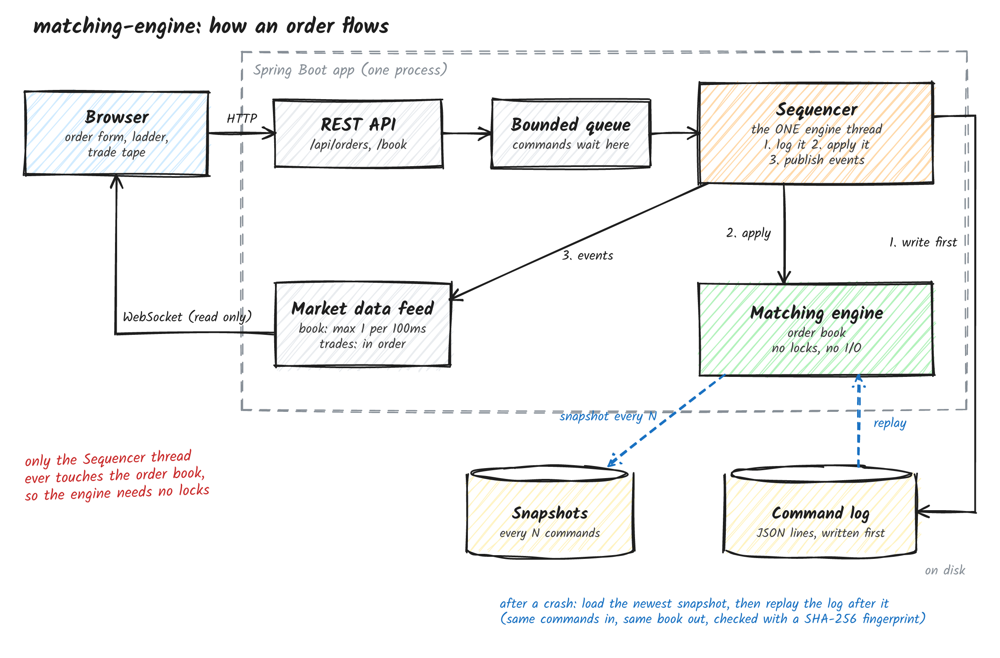

# Matching Engine

A stock exchange matching engine I built in Java 21 to learn how exchanges actually match orders. It matches buy and sell orders by price-time priority and streams the order book and trades to the browser live.

**Live demo:** https://matching-engine-hwru.onrender.com
Click **Simulate traffic** to fill the order book.



## What it does

- Limit orders (GTC, IOC, FOK) and market orders
- Cancel and modify. Reducing size keeps your place in the queue; changing price or adding size sends you to the back
- Best price matches first, then the earliest order at that price
- Order book ladder and trade tape update live over WebSocket

## How it works



Every command goes into a bounded queue. One sequencer thread takes it off the queue, gives it a sequence number, writes it to a log on disk, applies it to the order book, and then publishes the events. Only that one thread ever touches the book, so it needs no locks.

If the app crashes, the book is rebuilt by replaying the log, or from the latest snapshot plus the commands after it.

Prices are stored as whole paise (`long`), never `double`, so there are no rounding errors.

## What I learned from benchmarking

My first version stored price levels in a `TreeMap`. Profiling showed it was the biggest CPU cost, so I switched to sorted arrays. That made the engine about 23% faster, around 5.9M operations per second in JMH on my laptop (engine only, no network or logging). My first benchmark was also misleading, since almost a third of the orders were being rejected straight away, so I fixed the workload before trusting the numbers. Details are in [BENCHMARKS.md](BENCHMARKS.md).

## Testing

- 670 unit tests, 95.7% line coverage
- A seeded simulation runs 100,000 random operations and checks the order book after every single one. It caught a real sequence-number bug.
- Crash tests replay the log and compare a fingerprint of the rebuilt book with the original

## Run it

Needs Java 21 and Maven.

```bash
mvn test
mvn spring-boot:run
```

Open http://localhost:8080

Or with Docker:

```bash
docker build -t matching-engine .
docker run -p 8080:8080 matching-engine
```

## Known limits

- One symbol, one process
- No login or rate limiting
- The log is flushed but not fsynced

## Next

- Multiple symbols, each with its own engine and log
- A binary protocol instead of JSON
- A ring buffer in place of the blocking queue
